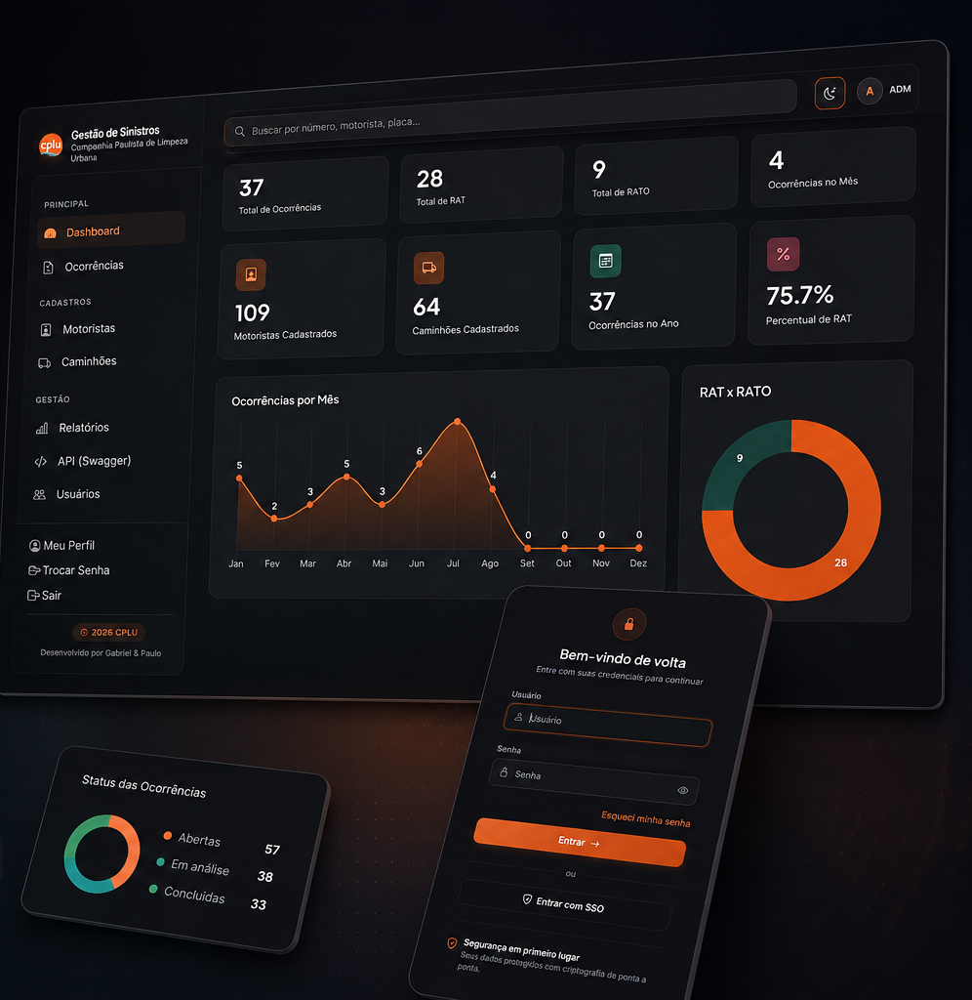

# Portfólio · Gabriel Rodrigues de Oliveira

Meu portfólio pessoal como desenvolvedor de software e web: projetos, formação, experiência, processo de trabalho e contato.

**🔗 Acesse:** https://gabrielroliveira98-cell.github.io/portfolio/

## ✨ Destaques

- Visual editorial escuro com tipografia serifada
- Seções Sobre, Trabalhos, Processo e Contato, com links diretos para os projetos e repositórios
- Animações de entrada com `IntersectionObserver`, respeitando `prefers-reduced-motion`
- Navegação que destaca a seção atual e menu mobile acessível
- Layout responsivo
- HTML, CSS e JavaScript puros, publicado no GitHub Pages

## 🗂️ Projetos apresentados

Gestão de Sinistros (CPLU), Sinistros SaaS, Patrimônio+, ErgoWork, ALTIER Barbearia, Prime Fitness, Gustavo Reparos & Obras e SenseBin.

## 📬 Contato

- LinkedIn: [/in/gabriel-r-oliveira-dev](https://www.linkedin.com/in/gabriel-r-oliveira-dev)
- E-mail: gabrielroliveira98@gmail.com
- WhatsApp: [(11) 95583-8101](https://wa.me/5511955838101)
